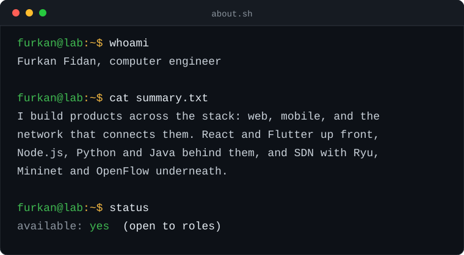
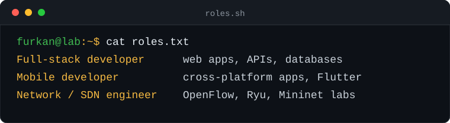
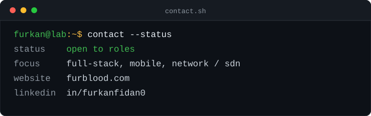

  

  <strong>Computer Engineer</strong>

 

  

  

---

### Skills

<table>
  <tr>
    <td width="130"><b>Web</b></td>
    <td>
      
      
      
      
      
    </td>
  </tr>
  <tr>
    <td><b>Mobile</b></td>
    <td>
      
      
      
    </td>
  </tr>
  <tr>
    <td><b>Backend</b></td>
    <td>
      
      
      
    </td>
  </tr>
  <tr>
    <td><b>Data</b></td>
    <td>
      
      
    </td>
  </tr>
  <tr>
    <td><b>Network / SDN</b></td>
    <td>
      
      
      
      
    </td>
  </tr>
  <tr>
    <td><b>Infra &amp; tools</b></td>
    <td>
      
      
      
    </td>
  </tr>
</table>

---

### Most used languages

  

---

### Work

The repositories pinned on this profile are the ones I'd walk through first. More projects, experiments and writing live at **[furblood.com](https://furblood.com)**.

---

### Contact

  

  <a href="https://furblood.com">furblood.com</a> &nbsp;·&nbsp;
  <a href="https://www.linkedin.com/in/furkanfidan0/">linkedin.com/in/furkanfidan0</a>

